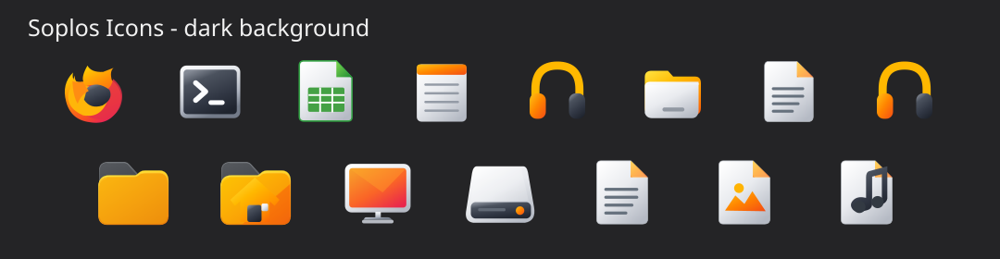
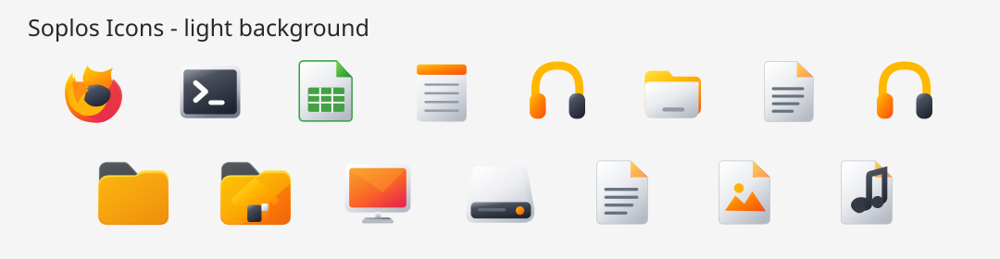

# Soplos Icons


An original SVG icon theme for Soplos Linux, using a warm amber and orange
palette with red and graphite accents.

The repository contains one theme:

| Theme | Install folder | Inherits |
|-------|----------------|----------|
| Soplos Icons | `Soplos` | `Adwaita`, `breeze`, `hicolor` |

The inherited themes provide fallback icons that are not included here. They
must be installed separately for complete fallback coverage.

## Preview

Dark background:



Light background:



The previews show examples of the application, folder, device and file-type
icons, rendered from the theme's SVG files.

## What is included

- 1,228 SVG icon names, drawn by 1,095 files and their aliases: scalable icons
  across apps, places, devices, mimetypes, categories, actions, status and
  emblems, and symbolic icons for places, actions, status and emblems.
- Freedesktop-compatible `index.theme` metadata.
- A user-local installer and uninstaller; no `sudo` is required.
- Support for KDE Plasma, GNOME, Xfce and other desktops that follow the
  freedesktop icon theme specification.

## Installation

### Debian package

On Soplos Linux and other Debian-based systems, the `soplos-icons` package
installs the theme for every user in `/usr/share/icons/Soplos/`:

```bash
sudo apt install ./soplos-icons_1.0.0_all.deb
```

It recommends the Adwaita, Breeze and hicolor themes, where the missing icons
come from.

### User installation

Clone or download this repository, then run the installer from its directory:

```bash
./install.sh
```

The theme is installed in `~/.local/share/icons/Soplos/` (or
`$XDG_DATA_HOME/icons/Soplos/` when `XDG_DATA_HOME` is set).

Select **Soplos Icons** in your desktop's icon settings:

- **KDE Plasma:** System Settings → Colors & Themes → Icons.
- **GNOME:** GNOME Tweaks → Appearance → Icons.
- **Xfce:** Settings → Appearance → Icons.

You can also select the theme from a terminal:

```bash
# GNOME
gsettings set org.gnome.desktop.interface icon-theme 'Soplos'

# Xfce
xfconf-query -c xsettings -p /Net/IconThemeName -s 'Soplos'
```

The installer does not overwrite an existing installation. To remove the
current copy before reinstalling, run:

```bash
./uninstall.sh
```

Then run `./install.sh` again. The same uninstaller removes the theme when you
no longer need it.

## Editing the icons

The artwork is in `scalable/`, organized by Freedesktop icon category. The
included icons are SVG files and can be edited with Inkscape or another SVG
editor.

## Credits

Original artwork by Sergi Perich and Juanjo Menent, created for the Soplos Linux
project. Missing icons are resolved
through the inherited Adwaita, Breeze and hicolor themes; their artwork remains
part of those respective projects.

## License

Copyright © 2026 Sergi Perich and Juanjo Menent.

The icons are licensed under the
[Creative Commons Attribution-ShareAlike 4.0 International License](LICENSE)
(CC BY-SA 4.0): you may use, change and share them as long as you credit the
authors and share your versions under the same license.

Some icons depict the logos of third-party applications. Those logos and names
are trademarks of their owners; the license covers the drawings and grants no
rights over the trademarks.
